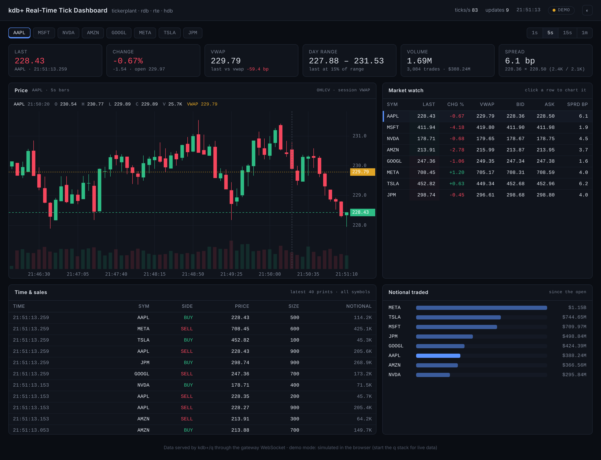
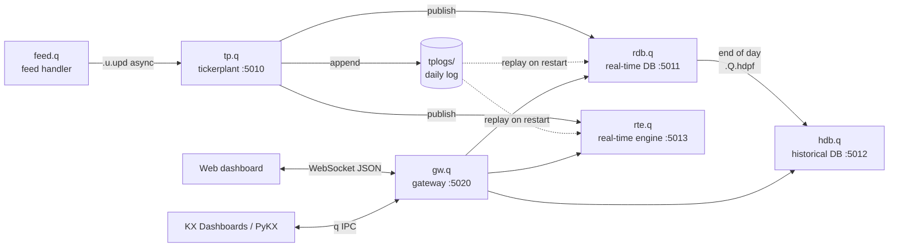

# kdb-realtime-tick-dashboard

End-to-end real-time tick data platform built on **kdb+/q**: tickerplant, real-time database, real-time analytics engine, historical database and a gateway, with a live trading dashboard on top (browser over WebSocket, or **KX Dashboards** over q IPC).



**▶ [Live demo](https://matthieu-briche.github.io/kdb-realtime-tick-dashboard/web/index.html?demo)**: runs in your browser, no install (simulated prices).

## Highlights

- **Classic kdb+tick architecture**, written from scratch and commented: feed → tickerplant → RDB / RTE → HDB, with a single gateway in front.
- **No data loss**: every tick is written to a daily tickerplant log; the RDB and RTE replay it on restart.
- **Incremental analytics**: the real-time engine maintains session OHLC, volume, notional, VWAP and top of book per symbol, so dashboard queries cost O(symbols), not O(ticks).
- **One port, three protocols**: the gateway answers q IPC (KX Dashboards, PyKX), serves the web dashboard over HTTP and pushes JSON snapshots over WebSocket.
- **Automatic end of day**: at midnight the RDB writes a date partition to the HDB and the stack rolls to a new log.
- **Zero-dependency dashboard**: a single HTML file with a hand-drawn canvas candlestick chart; it also runs in a fully simulated demo mode without kdb+.

## Architecture



| Process | Port | Role |
|---|---|---|
| `tp.q` | 5010 | Stamps, logs and publishes every tick; manages subscriptions and end of day |
| `rdb.q` | 5011 | Holds today's trades and quotes in memory; bars, tape, spread queries |
| `hdb.q` | 5012 | Date-partitioned history on disk (`db/`) |
| `rte.q` | 5013 | Streaming analytics: OHLC, VWAP, volume, notional, top of book |
| `gw.q`  | 5020 | Public API, static web server and WebSocket push |
| `feed.q` | – | Simulated random-walk trades and quotes (swap for a real feed) |

## Quick start

**Requirements:** kdb+ 4.x or KDB-X with a valid licence (the free personal/community licence is enough), `q` on your `PATH`, Linux or macOS (Windows: use WSL).

```bash
git clone https://github.com/matthieu-briche/kdb-realtime-tick-dashboard.git
cd kdb-realtime-tick-dashboard
./scripts/start.sh
```

Once the stack is running, open `http://localhost:5020/index.html` on the same machine. Prices start moving immediately.

```bash
q scripts/smoke_test.q      # end-to-end checks against the running stack
tail -f logs/*.log          # follow every process
./scripts/stop.sh           # stop everything
```

No kdb+ licence at hand? Try the [live demo](https://matthieu-briche.github.io/kdb-realtime-tick-dashboard/web/index.html?demo), or open `web/index.html` directly in a browser (or add `?demo` to the URL): the dashboard runs on an in-browser simulator with the exact same data shape.

### Configuration

All ports and the feed rate are environment variables of `start.sh`:

```bash
GW_PORT=8080 FEED_RATE=50 ./scripts/start.sh
```

The feed accepts its own options, e.g. `q src/feed.q -syms AAPL,MSFT,BTCUSD -batch 30 -sigma 0.0005`.

## Data model

Defined once in [`schema/sym.q`](schema/sym.q) and sent to every subscriber by the tickerplant.

```q
trade:([] time:`timespan$(); sym:`g#`symbol$(); price:`float$(); size:`long$(); side:`symbol$())
quote:([] time:`timespan$(); sym:`g#`symbol$(); bid:`float$(); ask:`float$(); bsize:`long$(); asize:`long$())
```

## Gateway API

Connect to the gateway (`hopen 5020` from q, `pykx.SyncQConnection(port=5020)` from Python, or a KX Dashboards connection) and call:

| Function | Source | Returns |
|---|---|---|
| `getStats[]` | RTE | Per symbol: open, high, low, lastPx, volume, notional, trades, vwap, chgPct |
| `getTop[]` | RTE | Per symbol: bid, ask, sizes, mid, spreadBps |
| ``getBars[`AAPL;5;300]`` | RDB | Last 300 OHLCV bars of 5 seconds, with per-bar VWAP |
| `getTape[50]` | RDB | Latest 50 trades, newest first |
| ``getSpread[`AAPL;10]`` | RDB | Mid price and spread sampled every 10 seconds |
| `getVolume[]` | RDB | Volume, notional and trade count per symbol |
| ``getHistBars[`AAPL;2026.10.01;2026.10.23;15]`` | HDB | 15-minute bars across a date range |
| `getHistDaily[2026.10.01;2026.10.23]` | HDB | Daily OHLCV per symbol |
| `getDates[]` | HDB | Dates available on disk |

Symbols and dates may be passed as strings, so the API is easy to call from JSON-based tools.

```q
q)h:hopen 5020
q)h"getStats[]"
q)h(`getBars;`NVDA;15;100)
```

## Dashboards

### Web dashboard (`web/index.html`)

Served by the gateway itself. Each browser opens a WebSocket, chooses a symbol and a bar size, and receives a snapshot every 500 ms (`-push` option of `gw.q`):

- KPI tiles: last, change, VWAP and distance to VWAP, day range, volume, spread
- Candlestick chart with volume, session VWAP and last-price line, crosshair legend
- Market watch with price flashes; click a row to chart that symbol
- Time and sales across all symbols, notional traded per symbol
- Light and dark themes, responsive down to phone width

### KX Dashboards

Point a KX Dashboards connection at the gateway (`localhost:5020`) and build data sources on the API above. Step-by-step guide: [`docs/kx-dashboards.md`](docs/kx-dashboards.md).

## Project structure

```
kdb-realtime-tick-dashboard/
├── schema/sym.q          tick table definitions
├── src/
│   ├── tp.q              tickerplant
│   ├── rdb.q             real-time database + intraday query API
│   ├── hdb.q             historical database + history query API
│   ├── rte.q             real-time engine (incremental analytics)
│   ├── gw.q              gateway: API, HTTP, WebSocket push
│   └── feed.q            simulated feed handler
├── web/index.html        real-time web dashboard
├── scripts/
│   ├── start.sh          start the whole stack
│   ├── stop.sh           stop it
│   └── smoke_test.q      end-to-end checks
└── docs/
    ├── kx-dashboards.md  KX Dashboards setup guide
    └── screenshot.png
```

Generated at run time and ignored by git: `tplogs/` (tickerplant logs), `db/` (HDB partitions), `logs/` (process output).

## End of day and recovery

- At midnight (local time) the tickerplant sends `.u.end` to every subscriber and opens a new log file.
- The RDB saves each table as `db/<date>/<table>/`, sorted and parted by `sym`, then tells the HDB to reload.
- The RTE resets its session statistics.
- Restarting the RDB or the RTE at any time during the day replays the current log, so nothing is lost.
- To test it without waiting for midnight, run `.u.endofday[]` on the tickerplant (`q)h:hopen 5010; h".u.endofday[]"`).

## Going further

- **Real data**: replace `feed.q` with a feed handler for a broker or exchange API, Kafka (KX Fusion) or a crypto websocket; keep calling ``.u.upd[`trade; (syms; prices; sizes; sides)]``.
- **Batching**: publish on a timer from the tickerplant for very high message rates.
- **Scale-out**: run several RDBs filtered by symbol and route queries from the gateway.
- **Security**: add `.z.pw` authentication and restrict the gateway to the API functions.
- **More analytics**: order book reconstruction, realised volatility, TCA (slippage vs VWAP / arrival price) in the RTE.

## Licence

MIT, see [LICENSE](LICENSE). kdb+ and KX Dashboards are products of KX Systems and require their own licence.
